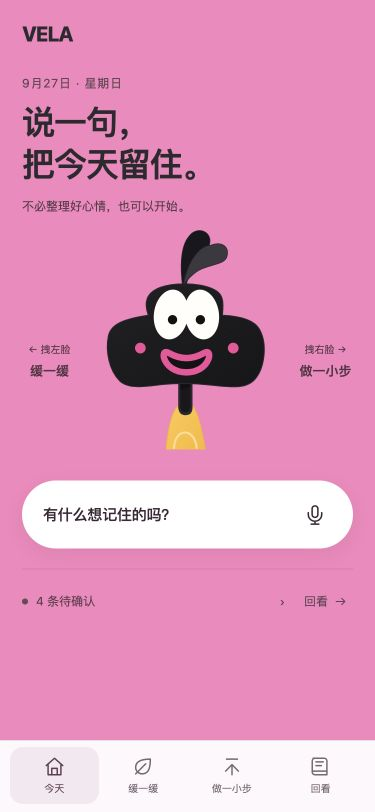
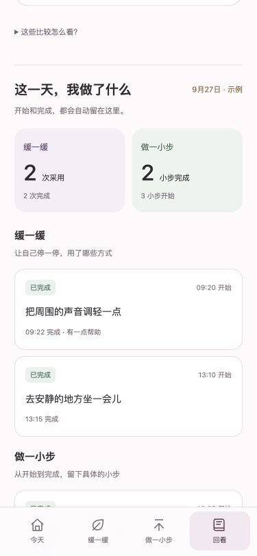
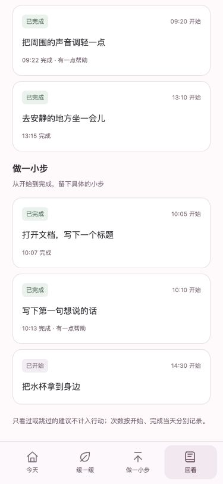

# VELA · 主动式 AI 节律伙伴

面向情绪易波动、生活节律容易失衡人群的独立产品原型。用更少的输入留下日常线索，在需要时“缓一缓”或“做一小步”，按日历回看节律与实际行动。

**这是评委可复现的代码与硬件证据仓库。核心流程无需模型密钥、无需 npm install。** 当前支持本机单用户运行；自动疾病识别、临床效果和全天主动采集不属于已实现能力。

## 先看界面

| 今天：拽左脸进入缓一缓，拽右脸进入做一小步 | 回看：每日节律与实际采用的方法 | 回看：具体完成的小步 |
| --- | --- | --- |
|  |  |  |

截图中的示例行动与节律数据为演示数据，不是患者数据。界面内的“看示例”和“我的记录”分开。

## 三步启动

需要 **Python 3.10+（推荐 3.12）**。现代 Chrome、Edge 或 Safari 均可访问本机页面。

```bash
git clone https://github.com/demifanholdon-ops/vela-demo.git
cd vela-demo
python3 -m backend.server
```

首次启动会重新解析约 9.2 万条 IMU 样本并核验校准，稍等终端显示 `VELA ready`，再打开：

- **App：** <http://127.0.0.1:4186/>
- **硬件证据与 Agent 工作台：** <http://127.0.0.1:4186/lab>
- **方案概览：** <http://127.0.0.1:4186/proposal.html>

Mac 可双击 `start.command`。Windows 将命令中的 `python3` 换成 `py`。端口冲突时使用 `python3 -m backend.server --port 4187`。这些是启动后在自己电脑上打开的地址，GitHub 本身不运行 Python 后端。

## 评委五分钟体验路线

1. 首页拖动左脸 / 右脸，或点击底部入口，进入“缓一缓”/“做一小步”。
2. 请求一个小支持 → “我想试试” → “我做到了” → 选择是否有帮助。
3. 打开“回看”，点选日期，在节律下方找到具体行动、开始和完成时间；刷新仍保留。点错反馈可以撤回。
4. 点“看示例”查看完整的睡眠、语速与情绪展示；切回“我的记录”，可手动补充睡眠和感受，缺失数据留空。
5. 首页点麦克风进入记录页。未安装本地语音模型时，可直接在文字框输入一句话或点“试试示例”，整理、核对并确认记录。“这一天的生活片段”内可修改或删除。
6. 打开 `/lab` 查看真实 IMU 数据质量、校准验证和 Agent 运行证据；云端功能默认关闭。

## 已实现与待验证

| 能力 | 当前可运行的内容 |
| --- | --- |
| UI/UX | 独立 VELA 品牌；双向拽脸导航；缓一缓、做一小步、日历回看 |
| 记录 | 本地文字分句；可选本地语音转写；可选云端语义整理；原句核对、修改、确认、删除 |
| 支持 Agent | 用户选择入口后，规则与个人方法库选择动作；开始、完成、跳过、效果反馈分别保存 |
| 每日回看 | 睡眠与本人感受可填写；近期统计参考；每日行动清单；跨日完成和反馈纠正统计 |
| 真实硬件证据 | BMI323 六面校准会话重放、样本质量检查、单位换算、校准验证及原始上位机源码 |
| 后续设计 | 硬件日常实时联动、主动场景识别、自动睡眠/语速/声音情绪、趋势触发支持、语音纠错、社群 |

“Agent”是有明确输入输出的处理节点，不表示每一步都调用大模型。参见 [架构与数据流](docs/ARCHITECTURE.md)。

## 硬件数据与复现

仓库包含硬件同学提供的六面校准工程数据：

```text
inputs/
├── report-0e27827d.json       # 校准参数、验证结果
├── HARDWARE-SHA256.json       # 硬件附件文件校验清单
└── hw/
    ├── data/20260926T141442.230441Z-0e27827d/
    │   ├── raw.bin           # 原始串口字节
    │   ├── samples.csv       # 92,047 条样本 + 1 行表头
    │   ├── events.jsonl      # 六面标签、静止段、设备事件
    │   └── metadata.json     # BMI323 / 100 Hz / ±4g / ±500 dps
    └── host/                 # 协议、采集、校准、姿态工具和测试
```

无需实体硬件即可重新分析：

```bash
python3 scripts/replay.py --output runtime/judge-replay.json
```

输出路径若存在，请换一个新路径。校准回代最大重力误差约 **0.53%**，工程阈值为 **2%**；这是校准数据的工程检查，不能解释为情绪识别准确率。数据不是佩戴者生活数据，也不含双相障碍访谈或病情标签。

原始采集文件与上位机源码保持附件字节一致。校准报告仅将原机器目录改为仓库相对路径，校准参数和校准 ID 不变。[完整硬件复现说明](docs/HARDWARE.md)

## 可选：本地语音

文字流程直接可用；语音需要独立安装依赖和模型，未配置时不会假装已转写。

```bash
python3 -m venv .venv
.venv/bin/python -m pip install -r requirements-asr.txt
.venv/bin/python -c "from huggingface_hub import snapshot_download; snapshot_download('Systran/faster-whisper-base', local_dir='models/whisper-base')"
```

安装和下载模型时需要联网；完成后重启服务，录音转写在本机进行。Windows 使用 `.venv\Scripts\python.exe`，并在 `.env` 中设置 `VELA_ASR_PYTHON` 为该解释器的绝对路径。浏览器录音需用户授权麦克风；最多两分钟。仓库中的 `artifacts/v02-synthetic-speech.wav` 是中性合成测试录音，可用于导入体验。

## 可选：云端模型

复制 `.env.example` 为 `.env`，配置自己的 OpenAI-compatible HTTPS 服务、密钥和模型名，再重启服务。密钥仅由后端使用，不提交 GitHub。

- 默认无需云端；失败时明确降级到本地结果。
- 工作台仅在本次同意后发送结构化工程摘要。
- 日记云端整理会在单独同意后发送当前文字，**不等同于“仅发送结构化数据”**。
- 原始录音不发送云端；转写临时音频处理后清除。
- 云端请求有总次数上限（当前 10 次）；不附带公共密钥或共享计费账号。

## 自动验证

```bash
python3 -m unittest discover -s tests -v
python3 scripts/http_smoke.py
node --test tests/*.test.mjs
npm run check
```

Node 测试推荐 Node 22+；无第三方前端依赖。HTTP 验证使用临时数据库及本机临时端口，不影响演示记录。附带 [GitHub Actions 验证配置模板](docs/verify-workflow.yml)，可放入 `.github/workflows/verify.yml` 后启用持续验证。当前发布前验证结果见 [验收记录](docs/RELEASE-CHECKS.md)。

## 数据与发布边界

服务只监听 `127.0.0.1`，记录保存在被 Git 忽略的 `runtime/`。本版本没有公网账户系统、多租户权限或应用层数据库加密，适合本机评审，不直接作为公开健康数据服务部署。

本次发布使用独立的干净 Git 历史；不包含模型密钥、个人日记数据库、私人原始录音、报名联系方式或原始私人 PRD。原启念 / MindLoop 仓库未改动。UI 来源与硬件资料说明见 [来源说明](NOTICE.md)。

[功能结构图](artifacts/diagrams/VELA_功能结构与体验流程.png) · [可编辑 SVG](artifacts/diagrams/VELA_功能结构与体验流程.svg) · [产品与验证范围](docs/PRODUCT.md)
