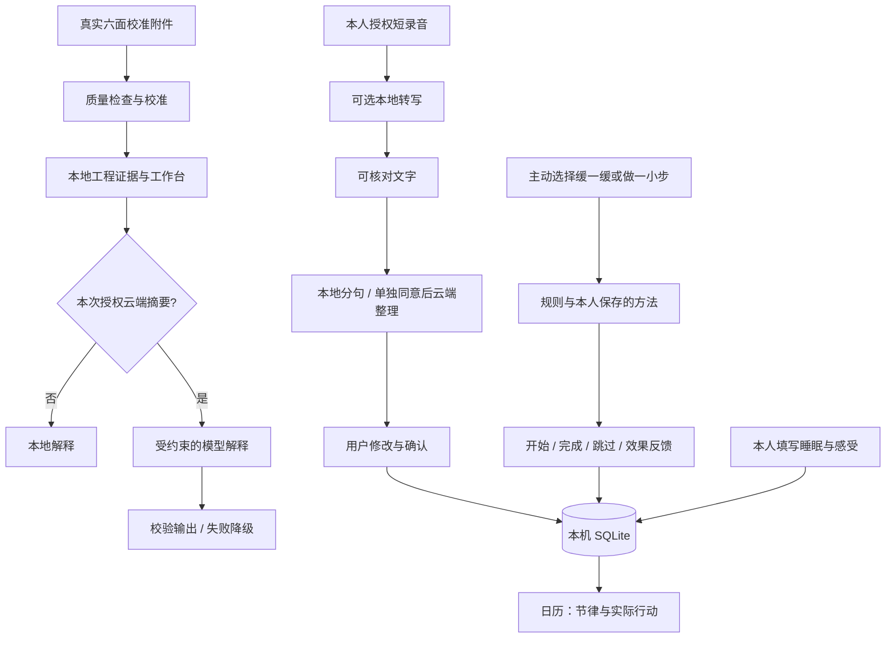

# 当前可运行架构

Python 标准库 HTTP 服务提供静态前端及 JSON API，SQLite 使用本机独立文件。前端为原生 JavaScript / CSS / Web Component，无构建步骤。接口写入要求本次启动的 token，并检查请求来源；不构成公网身份认证系统。

`backend/agents.py`：质量、证据、支持及可选云端解释节点；`journal.py`：整理与原句核验；`evidence.py`：IMU / WAV 工程证据；`rhythm.py`：日记录验证；`store.py`：持久化；`server.py`：API 与本机服务。

## 记录语义

未确认片段与本人确认内容分开。已发生的事、感受和计划保持可修改；本地分句不能代替语义理解。支持“开始”和“完成”分开记录，效果反馈不等于完成。修改反馈撤回旧执行状态，跨午夜操作归属各自本地日期。示例数据不进入本人的持久化数据。

## 隐私实现与后续目标

原音在本机转写的临时文件中处理并清除，默认不持久化；用户授权的文本日记、反馈保存在本机数据库。可选云端日记整理发送当前转写/输入文字，工作台模型发送结构化工程摘要；各自授权。当前无云端健康档案同步。

端侧进一步提取特征、云端仅接收必要结构化记录、全天事件触发采集和主动提醒属于后续设计。原型不做疾病诊断、分期、疗效评估或自动联系他人。
