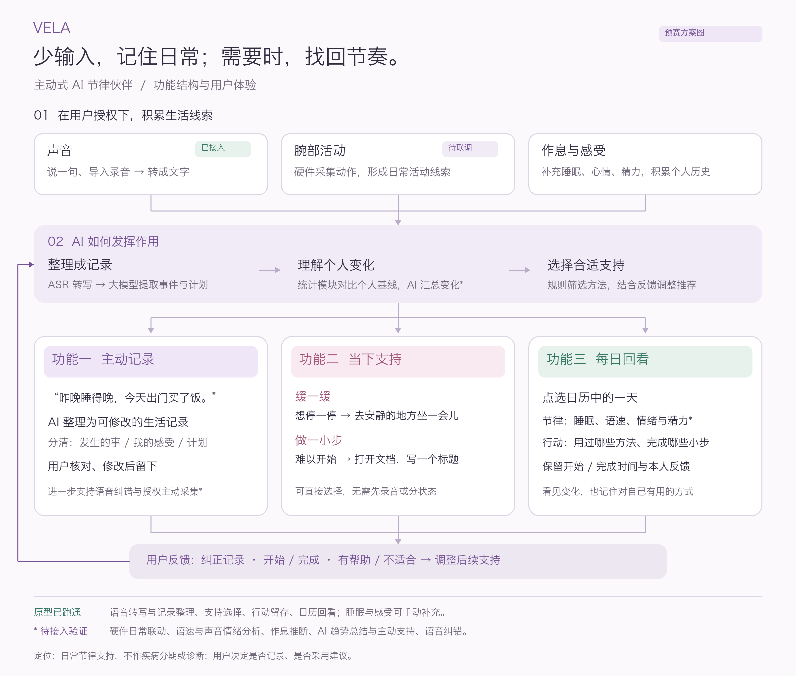

# 产品与验证范围

VELA 面向情绪易波动、生活节律容易失衡的成年人。首发聚焦双相障碍人群，后续逐步研究持续困扰但原因未明、压力中希望保持规律，以及 ADHD 等神经多样性人群的不同需求。

## 三个核心功能

1. 低输入记录：将随口表达整理为可核对的生活片段，区分事件、感受与计划。
2. 当下支持：用户选择缓一缓或做一小步，通过具体、可跳过的方法支持眼前的行动。
3. 每日回看：按日历同时呈现生活节律和真实采用的方法、完成的小步与反馈。

工业设计方向为传感器底座配可替换顶盖、表带与饰件，结合日常佩戴与个人审美；当前仓库没有量产结构、工艺验证或 Anker 官方合作证明。

## 验证计划

公开访谈用于理解场景和构造有来源的测试样本，不能单独成为诊断标准。下一步在用户授权的少量明确场景中验证事件提取、误提醒、纠错成本及总输入负担。录音与 IMU 日常同步、语速和声音情绪、主动触发均尚未验证。

时间测算（如每日记录从 4 分钟降至 1.5 分钟）、留存和社群推荐增长均为待验证假设，不是结果。本仓库优先提供可执行的工程与交互证据。

定位为消费级日常节律支持，不提供疾病诊断、治疗决策或替代专业照护的功能。产品监管属性仍取决于最终实际功能、用途与宣传。
